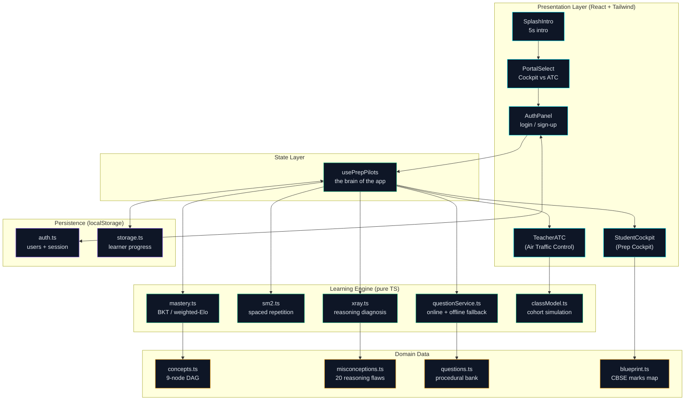
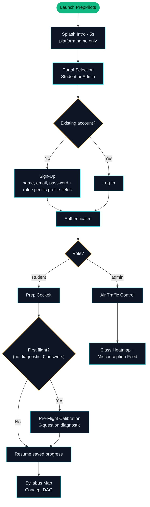
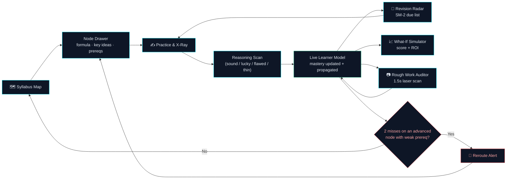
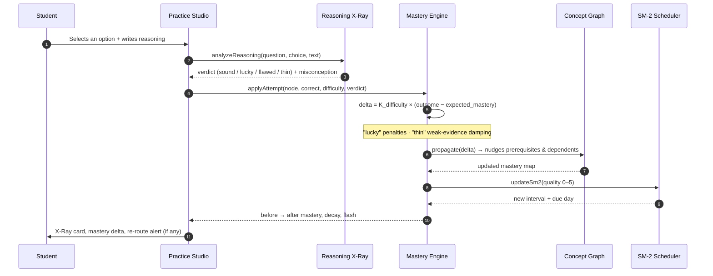
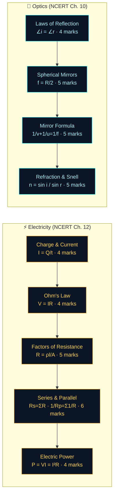

# ✈️ PrepPilots

**Adaptive Exam Prep Tutor with a Live Learner Model**
CBSE / NCERT **Class 10 Physics** — *Electricity* + *Light: Reflection & Refraction*

PrepPilots is not a quiz app. It is a **flight-simulator for your preparation**: it builds a live model of what a student actually understands, in real time, and constantly re-routes them toward the concepts that will move their board score the most.

Two portals. One learner model. Zero backend.

> **Student Portal → "Prep Cockpit"** &nbsp;·&nbsp; **Admin Portal → "Air Traffic Control"**

---

## 📑 Table of Contents

- [Why PrepPilots](#-why-preppilots)
- [Core Ideas](#-core-ideas)
- [Feature Tour](#-feature-tour)
- [System Architecture](#-system-architecture)
- [Application Flow](#-application-flow)
- [The Learner Model Pipeline](#-the-learner-model-pipeline)
- [Curriculum Coverage](#-curriculum-coverage)
- [Tech Stack](#-tech-stack)
- [Project Structure](#-project-structure)
- [Getting Started](#-getting-started)
- [Demo Accounts](#-demo-accounts)
- [Design System](#-design-system)

---

## 🎯 Why PrepPilots

Most ed-tech tools measure **answers**. PrepPilots measures **understanding**.

A student can get a numerical right by luck and still hold a broken mental model — PrepPilots catches that. It then diagnoses *why* they got it wrong, re-teaches the exact flaw, and re-schedules the concept using spaced repetition. Progress is persisted locally, so the whole product runs with **no server and no internet**.

---

## 🧠 Core Ideas

| Idea | What it means |
| --- | --- |
| **Live Learner Model** | Every concept node carries a mastery value that is updated after *every* answer — not at the end of a test. |
| **Reasoning, not just answers** | A written explanation is scanned to detect the *flawed mental model* even when the answer is correct. |
| **Concept Dependency Graph (DAG)** | Concepts are linked by prerequisites; mastery propagates through the graph. |
| **Prerequisite Reroute** | Fail an advanced node twice while its prerequisite is weak → the system flies the student back to the root. |
| **Spaced Repetition** | SM-2 scheduler decides *when* each concept must be revised. |
| **Reasoning X-Ray** | Maps a student's words to one of 20 catalogued Class-10 Physics misconceptions. |

---

## ✨ Feature Tour

### 👨‍✈️ Student Portal — *Prep Cockpit*

- **🎬 Splash Intro** — a cinematic 5-second name-only launch sequence.
- **🩺 Pre-Flight Calibration** — a 6-question diagnostic that seeds the entire graph with a BKT prior.
- **🗺️ Syllabus Map** — the interactive Concept Dependency Graph. Nodes glow by mastery band (Weak / Developing / Mastered). Click a node for its formula, key ideas and prerequisite readiness.
- **✍️ Practice & X-Ray** — targeted questions that auto-calibrate difficulty (Easy < 45%, Medium 45–75%, Hard > 75%) with a live reasoning scan of the student's written explanation.
- **📡 Revision Radar** — the spaced-repetition due list; concepts decay over time and surface when they need review.
- **📈 What-If Exam Score Simulator** — drag neon sliders to simulate mastery gains and see the projected board score, marks gained and **ROI per study hour**.
- **📷 Snap Your Rough Work** — a handwriting-OCR auditor with a 1.5-second laser scan, inline bounding boxes (green = valid, crimson = flawed) and one-click remediation that writes straight back to the learner model.
- **🚨 Prerequisite Reroute Alerts** — a prominent, actionable banner when a student is pushing too far ahead of their foundations.

### 🛰️ Admin Portal — *Air Traffic Control*

- **🌡️ Class Mastery Heatmap** — 35-student cohort × 9 concepts.
- **📊 Bottleneck Detection** — concepts where >40% of the class sits below 50%.
- **🔍 Misconception Feed** — the most common reasoning flaws across the class, with a live flag for the active learner.
- **👥 Student Roster** — per-student mastery band, attendance and flagged misconceptions.
- **📝 Remedial Plan Export** — auto-generates a structured, board-style remedial sheet for the weakest concepts + reasoning errors.

---

## 🏗 System Architecture

PrepPilots is a **100% client-side** React application. All state lives in `localStorage` and is namespaced per account.



---

## 🧭 Application Flow

From launch to learning — this is exactly what the user experiences.



### Student Cockpit — inner loop



---

## ⚙️ The Learner Model Pipeline

The heart of PrepPilots is a hybrid **Bayesian Knowledge Tracing + weighted-Elo** engine, coupled to an **SM-2** scheduler.



### Mastery update — the equation

```
delta  =  K(difficulty) × ( outcome − expected_mastery )

where
  K(Easy)=0.22   K(Medium)=0.30   K(Hard)=0.38
  outcome = 1.0  (correct · sound)
          = 0.8  (correct · thin reasoning,  K × 0.7)
          = 0.5  (correct · lucky,          K × 0.85)
          = 0.0  (incorrect)
```

### Retention decay (Revision Radar)

```
decayRate(node)   = 0.09 / (1 + 0.3 × reps)
decayFactor(node) = e^(−decayRate × daysSinceReview)
effectiveMastery  = mastery × decayFactor
```

The more times a node has been successfully revised, the slower it decays — exactly like a real memory.

### Difficulty auto-calibration

| Mastery | Difficulty |
| --- | --- |
| < 45% | Easy |
| 45% – 75% | Medium |
| > 75% | Hard |

### Prerequisite Reroute rule

> If a student **fails an advanced node twice** while a prerequisite sits **below 60%**, PrepPilots raises a *Prerequisite Reroute Alert* and flies them back to the root concept.

---

## 📚 Curriculum Coverage

Nine concept nodes across two authentic CBSE Class 10 Physics lanes, each carrying its **board-exam weightage**.



The **20-entry misconception catalog** encodes real Class-10 reasoning flaws, e.g.:
- *Additive Resistance Fallacy in Parallel Circuits*
- *Current is "used up" as it passes through resistors*
- *Resistance depends on voltage*
- *Concave mirror always forms a real image*
- *Frequency of light changes during refraction*

Each misconception ships with its exact flaw, the correct frame, a formula anchor, a 30-second micro-lesson, and text **triggers** used by the X-Ray.

---

## 🧰 Tech Stack

| Layer | Choice |
| --- | --- |
| Framework | **React 18** + **TypeScript 5** |
| Build tool | **Vite 5** |
| Styling | **Tailwind CSS 3** (custom design tokens, glassmorphism) |
| Icons | **lucide-react** |
| State | React hooks + `localStorage` (per-account namespacing) |
| Algorithms | BKT / weighted-Elo, SM-2 spaced repetition, DAG propagation |
| Backend | **None** — offline-first. An *optional* `/api/generate-question` endpoint is used when present, with a built-in offline generator as fallback. |

---

## 🗂 Project Structure

```
default/
├── index.html                 # App shell + Google Fonts + SVG favicon
├── package.json
├── vite.config.ts
├── tailwind.config.js
├── postcss.config.js
├── tsconfig.json
└── src/
    ├── main.tsx               # React entry
    ├── App.tsx                # Splash → Portal → Auth → Shell
    ├── index.css              # Design tokens, glass utilities, animations
    ├── types.ts               # Shared domain types
    │
    ├── data/                  # Static curriculum
    │   ├── concepts.ts        #   9-node Concept Dependency Graph
    │   ├── misconceptions.ts  #   20-entry reasoning-flaw catalog
    │   ├── questions.ts       #   Procedural question + diagnostic generator
    │   └── blueprint.ts       #   CBSE marks weightage + ROI math
    │
    ├── lib/                   # Pure learning engine
    │   ├── mastery.ts         #   BKT/weighted-Elo + propagation + reroute
    │   ├── sm2.ts             #   SM-2 spaced-repetition scheduler
    │   ├── xray.ts            #   Reasoning diagnosis + quick-fill chips
    │   ├── questionService.ts #   Optional online generation + offline fallback
    │   ├── classModel.ts      #   35-student cohort + remedial plan builder
    │   ├── auth.ts            #   Local auth store (hashed passwords)
    │   ├── storage.ts         #   Per-account learner-state persistence
    │   └── theme.ts           #   Dark / Light theme tokens
    │
    ├── state/
    │   └── usePrepPilots.ts   # The brain — wires engine + persistence to UI
    │
    └── components/
        ├── SplashIntro.tsx    ├── PortalSelect.tsx
        ├── AuthPanel.tsx      ├── TopNav.tsx
        ├── ProfilePanel.tsx   ├── ThemeToggle.tsx
        ├── Primitives.tsx     ├── Logo.tsx
        ├── student/           # Prep Cockpit
        │   ├── StudentCockpit.tsx   ├── ConceptGraph.tsx
        │   ├── NodeDrawer.tsx       ├── PracticeStudio.tsx
        │   ├── XRayCard.tsx         ├── RetentionRadar.tsx
        │   ├── WhatIfSimulator.tsx  ├── RoughWorkAuditor.tsx
        │   └── DiagnosticModal.tsx
        └── teacher/           # Air Traffic Control
            ├── TeacherATC.tsx       ├── MasteryHeatmap.tsx
            ├── StudentRoster.tsx    └── MisconceptionFeed.tsx
```

---

## 🚀 Getting Started

```bash
# 1. install dependencies
npm install

# 2. start the dev server
npm run dev          # → http://localhost:5173

# 3. type-check + production build
npm run build

# 4. preview the production build
npm run preview
```

**Requirements:** Node.js 18+ and npm.

> **Optional online question generation** — set `VITE_QUESTION_ENDPOINT` to a POST
> endpoint that returns `{ "question": { stem, options[4], correctIndex, explanation } }`.
> If it is missing, slow, or malformed, PrepPilots silently falls back to its built-in
> offline generator, so a live demo never breaks.

---

## 🔑 Demo Accounts

Seed accounts are created automatically on first launch.

| Portal | Email | Password |
| --- | --- | --- |
| Student | `aarav@preppilots.in` | `prep1234` |
| Admin | `meera@preppilots.in` | `prep1234` |

Or create your own account — student sign-up captures school, class/section; admin sign-up captures designation, subject, experience and employee ID.

---

## 🎨 Design System

A premium **aviation instrument** aesthetic — glassmorphism on a deep Obsidian canvas, with a neon accent palette.

| Token | Value |
| --- | --- |
| Background (Obsidian) | `#090D16` |
| Cyan (primary) | `#00F0FF` |
| Emerald (mastered) | `#10B981` |
| Amber (developing) | `#F59E0B` |
| Crimson (weak / alert) | `#EF4444` |
| Violet (ATC) | `#8B5CF6` |

- **Dark & Light** themes via `ThemeToggle`.
- `prefers-reduced-motion` respected across animations.
- Frosted glass cards, animated grid backdrops, and "sweep" light effects on primary actions.
- All data- and progress-persistence is local — refresh-safe by design.

---

<p align="center">
  <b>PrepPilots</b> · Adaptive Exam Prep Tutor with a Live Learner Model<br/>
  CBSE / NCERT Class 10 Physics · Electricity &amp; Light · BKT + SM-2 engine
</p>
